# CryptoNews architecture

The latest implemented phase is Phase 11. Read [deployment readiness](DEPLOYMENT_READINESS.md), [staging QA](STAGING_QA_CHECKLIST.md) and the [production runbook](PRODUCTION_RUNBOOK.md) for current verification and blockers. Earlier sections preserve their historical behavior and verification results; the README provides the current local operator workflow.

## Phase 04.1.2 local logos and commodity coverage

This phase supersedes the earlier ticker-control and two-metal descriptions. The shared anonymous ticker component has no button markup or reserved control column. Natural-width duplicate lists remain inert/aria-hidden, and the measured original width defines the loop distance. Hover and focus pause via CSS; passive touch handlers pause during interaction. Mobile and reduced-motion presentations remain static, locally contained scroll regions. No navigation or masthead geometry was changed.

The asset-icon component renders a fixed 20px image from the trusted local configuration, preserves aspect ratio and falls back to a neutral file for unknown, missing or unsafe mappings. A one-shot client error handler covers failed image loads without recursion. Nine authentic project logos are stored locally, with original Bitcoin/Solana repository notices. Cardano uses a neutral fallback because its published minimum logo sizes exceed this compact presentation. Locally authored metal icons distinguish the four precious metals from copper wire. The README records every source and the trademark limitations; no logo API or per-page external image request exists.

The existing metals adapter and transport allowlist now support XAU, XAG, XPT, XPD and HG at fixed USD endpoints. The four precious-metal responses must use oz (normalized to troy_ounce); copper must use lb (normalized to pound). Symbol/currency/unit mismatches are rejected before normalization and cannot overwrite last-good cache entries. Copper's per-pound label is visible in the compact ticker; localized currency notes explain both units. Undocumented rolling-24-hour metal changes remain null. The service, encrypted shared snapshot, cache reservations/locks, scheduler, backoff and attribution are reused.

Five sequential requests with two bounded eight-second attempts each can consume 81.25 seconds including retry delays. Only the metals job timeout increases to 85 seconds; crypto remains 50. Both are below the existing 90-second lock/retry interval, with the same 120-second unique-job lifetime and one attempt. Production operators must preserve these timing relationships and validate actual load/worker signal support. Visitor rendering still only reads cache, and DEMO still uses the six original fixtures.

At unchanged ten/thirty-minute intervals, successful 30-day usage is 4,320 crypto plus 7,200 metals requests (11,520 total); 31 days is 11,904. Bounded retries/cooldowns and provider entitlements still apply. DEMO remains enabled and makes zero requests. No credential, subscription, schema, dependency, SEO, admin or stored-content change occurred.

All 230 tests and 8,020 assertions pass, including HTTP-fake coverage for five metals, wrong units, failure retention, eight-language rendering and safe icon mapping/fallbacks. Pint, build and Blade compilation passed. Local HTTP checks verified all eight homepages and fifteen image URLs. Simulated JS checks cover animation eligibility, touch and image errors; they do not validate DOM geometry. Browser navigation/screenshots failed, so the six requested widths and actual loop smoothness remain visually unverified. Phase 04.1.2 is complete; Phase 05 has not started.

Phase 01 establishes the application and data model. Phase 02 adds premium public discovery; Phase 03 expands the article reader and multilingual SEO. Full editorial CRUD, AI integrations, live market feeds, comments, and advertising remain deferred. Earlier foundations are preserved below, followed by phase-specific additions.

## Application boundaries

- Laravel handles routing, sessions, validation, database access, queues, and scheduling.
- Blade renders the public homepage, paginated news listing, and article reader. Filament uses Livewire and its bundled Alpine runtime for the admin panel; do not load a second Alpine instance there.
- Vite compiles Tailwind CSS 4 and the public JavaScript entry point. System fonts support Cyrillic and Armenian without a remote font dependency.
- `config/news.php` declares eight public locales: `en`, `ru`, `fr`, `de`, `es`, `it`, `ja`, `zh`. `SetLocale` validates the URL locale and sets the request locale. English is the default and fallback for UI strings; article queries require a real translation in the requested language. Historical Armenian records remain stored behind explicit legacy redirects. Phase 04.1 details below supersede historical phase descriptions.
- `/` redirects to `/en`. Named public routes carry their locale explicitly. Language links preserve the current page type and reset pagination.
- Admin routes are unprefixed at `/admin`, with English admin UI initially. No public registration is enabled.

## Data ownership

| Table | Responsibility |
| --- | --- |
| `users` | Authentication; `is_admin` is false by default and excluded from mass assignment. |
| `articles` | Shared author, primary category, editorial status, publication date, featured image path, content origin, reviewer and approval date. |
| `article_translations` | Locale, title, slug, excerpt, body, localized SEO title/description, canonical URL and social image path. |
| `categories` | Shared category identity and display order. |
| `category_translations` | Locale, display name, slug, description and localized SEO fields. |
| `tags` | Shared tag name and unique slug; localized tag labels can be introduced in a later migration. |
| `article_tag` | Unique article/tag pairs, with a reverse lookup index. |

Translation tables enforce one row per entity and locale, plus unique `(locale, slug)` pairs. Slugs are explicitly stored, rather than derived on every request; Armenian text is preserved in UTF-8. Slug length is 190 characters for portable MySQL composite indexes. Use lowercase, normalized slugs in future write forms. MySQL defaults to `utf8mb4` with `utf8mb4_unicode_ci`; SQLite uses its native UTF-8 encoding. SQLite and MySQL differ in collation behavior; validate slugs consistently before future writes.

Foreign keys protect references. Deleting a parent article/category cascades its translations; pivot rows cascade when an article or tag is deleted. Author deletion is restricted while articles reference that author. Category and reviewer deletion set the corresponding article reference to null. Articles support soft deletion to make later editorial deletion reversible.

The `ArticleStatus` enum defines `draft`, `pending_review`, `published`, and `archived`. Status is stored as an indexed string for easy future extension. `ContentSource` distinguishes `manual` and `ai`; this is only a persistence boundary, with no AI client or integration installed. Reviewer and approval timestamps prepare for a later approval workflow; Phase 01 does not implement that workflow or require approval to publish.

`Article::published()` selects published, non-deleted articles with a non-null publication date at or before the current time. `Article::inLocale()` requires an actual translation in the requested language and eager-loads it. Missing translations are not silently displayed as another language. Public lists order by publication time and ID for stable pagination. Both scopes must be applied for future public article endpoints.

## Administration and future modules

`User::canAccessPanel()` requires the `admin` panel ID and a true `is_admin` flag, including in local mode. Filament's session authentication, CSRF protection, and login throttling remain enabled. `app:create-admin` validates an email and a strong, confirmed password using hidden prompts. It creates a new account; it never silently promotes or overwrites an existing account. No credentials are stored in seeders or command arguments.

The admin provider discovers resources, pages, and widgets under `app/Filament`. Navigation group order is reserved for **Editorial**, **Audience**, **Automation**, and **System**. Future News/Categories resources belong to Editorial; Users/Comments to Audience; AI Agents to Automation; SEO/Settings to System. Phase 01 exposes only the functional dashboard; empty modules and misleading links are deliberately not added. Future resources need explicit policies before exposing write operations.

## Runtime services

- SQLite is the development default. MySQL uses the same migrations through Laravel's schema builder; a live MySQL server has not been tested in this environment.
- Sessions, cache, jobs, job batches, and failed jobs use database tables. Worker timeout should stay below the queue connection's retry interval.
- Email uses the log transport locally. Logs and local mail content are ignored by Git.
- The private `local` disk is the default. Public article images may use the `public` disk and `/storage` symlink; store relative paths in database fields.
- Dates are stored and compared in UTC. Locale controls language, not database timezone.
- `routes/console.php` contains scheduled maintenance. A scheduler process or an every-minute production runner is required; merely defining a schedule does not execute it.
- No external credentials or API clients are configured in Phase 01. Add future credentials to environment variables via configuration files, never source code.

## Verification and safety

Feature tests use an isolated SQLite `:memory:` database, array sessions/cache, and synchronous queues. Tests cover locales and language navigation, publication visibility, pagination, admin login and authorization, administrator creation, relationships, translation uniqueness, and foreign keys. They never reset the local development database. Do not use `migrate:fresh` against user data.

Commit the Composer and npm lockfiles. Ignore `.env*` except `.env.example`, SQLite files, generated assets, vendor modules, logs, caches and local tooling. The Windows Composer wrapper downloads and verifies a current executable under ignored `.tools/`, leaving the old system Composer untouched.

## Official references

- [Laravel 13 installation](https://laravel.com/docs/13.x/installation)
- [Laravel 13 localization](https://laravel.com/docs/13.x/localization)
- [Laravel 13 migrations](https://laravel.com/docs/13.x/migrations)
- [Laravel 13 queues](https://laravel.com/docs/13.x/queues)
- [Laravel 13 scheduler](https://laravel.com/docs/13.x/scheduling)
- [Filament 5 installation](https://filamentphp.com/docs/5.x/introduction/installation)
- [Filament 5 user authorization](https://filamentphp.com/docs/5.x/users/overview)

## Phase 02 public frontend

`NewsFeed` is the shared query boundary for public stories. Every collection starts with `published()` and `inLocale()`, then eager-loads authors, tags, and category translations. Editorial picks and analysis use the existing `editors-pick` and `analysis` tag slugs. They are editorial selections, not fabricated popularity statistics. The latest public story leads the homepage; featured placement does not change publication status.

`NewsIndexRequest` validates query shape and size before searching. Listing parameters are `q`, `category`, `topic=crypto|metals|analysis|opinion`, and `page`. Search uses parameter-bound LIKE expressions with a fixed escape character; input cannot alter SQL structure and wildcard characters are literal. Matching is confined to the requested translation. Database collation determines case sensitivity: SQLite does not provide complete Unicode case folding by default. Text is stored and matched as Unicode; exact-script searches work. MySQL uses its configured UTF-8 collation.

Categories are filtered by numeric ID. Category navigation identifies standard topics by their English slug while displaying their actual current-language translation. It loads English/current translations together in one eager query. Missing topic destinations are rendered as text, not dead links. The metals filter selects categories whose English slug is gold or silver. Search results retain filters in pagination. `FrontendLinks` preserves validated discovery parameters across languages and resolves actual localized article slugs on reader pages. Missing article translations produce no alternate link or fake fallback URL.

The additional `news.show` route is a minimal reader needed for functional story links. It applies the public scopes before resolving a localized slug, serves 404 for unpublished/scheduled/missing translations, escapes metadata and body text, and does not render untrusted HTML. Full detail-page design remains outside this phase.

Anonymous Blade components share article cards, metadata, original inline icons, headings, pagination, language navigation, editorial selections, markets, empty states and the newsletter preview. The icon component is named `ui-icon` to avoid the icon name already registered by Filament's Blade Icons dependency. Design tokens, breakpoints, focus states, reduced-motion rules and optional skeleton styles live in the Vite/Tailwind entry stylesheet. Public JavaScript only manages search visibility, menu dismissal, header elevation and local image fallbacks. Content and filters render on the server; skeletons are not displayed unnecessarily.

Original code-authored SVG illustrations are stored locally under `public/images/editorial`. Uploaded article paths resolve through the public storage disk; unsafe external/path-traversal values use the local fallback. Hero images are eager with high fetch priority, while cards below the fold are lazy. Images have explicit intrinsic dimensions and CSS aspect ratios. No fonts or image services are fetched from third parties.

`config/markets.php` contains deliberately fixed fictional prices and sparkline coordinates. The ticker and overview label them as demo data. `DemoNewsSeeder` is optional and refuses environments other than local/testing, even when invoked with production confirmation bypassed. Its hand-authored trilingual fixture data lives in `database/seeders/data/demo-news.php`; no translation service is installed or called. An explicit transaction creates missing records only; existing demo slugs are skipped and existing records are never updated. A `cryptonews-demo` tag identifies fictional articles. A random-password, non-admin author owns newly seeded content. No schema migrations were required for Phase 02.

The newsletter is an honest informational preview with no email collection or submission endpoint. There are no placeholder legal links or fake subscription confirmations. Admin providers, authentication, database services and existing migrations are unchanged.

## Phase 03 reader, content safety and SEO

`ArticleController` retains the original localized route and public query boundary. It assembles content, metadata, media, editorial selections and related stories using small dedicated services. The reader adds semantic breadcrumbs and header information, sanitized article typography, conditional summaries/contents, sharing and related reading. The content column and sidebar preserve the dark design system. Copying, reading progress and back-to-top behavior are progressively enhanced; navigation and reading work without JavaScript. There are no new admin modules, market APIs, AI clients or user write endpoints.

`ArticleContent` supports existing plain-text bodies and allowlisted editorial HTML without mutating storage. Symfony HTML Sanitizer 8.1.11 was already installed and is now declared directly in Composer. Its explicit allowlist retains useful formatting while rejecting active elements, untrusted styles/classes, event handlers and unsafe URL schemes. Body media is restricted to local/same-host HTTP(S) resources. Safe DOM post-processing normalizes headings, assigns unique IDs, remaps matching anchor links and wraps tables for keyboard-accessible scrolling. TOC titles and estimated reading time come from the sanitized output. Standalone non-editorial markup stays escaped as plaintext for backwards compatibility. The sanitizer's default short input cap is disabled so long stored articles are not silently lost.

`ArticleMedia` validates local paths and checks actual file existence. A missing hero uses existing local illustration artwork; missing sources are not emitted as article/social image claims. Alt text describes the headline illustration or fallback. Inline image captions remain actual author-supplied content; no default photo credits are fabricated.

The additive summary migration introduces nullable `article_translations.summary` (JSON) and `summary_source` (string). `summaryPoints()` accepts only a 3–5 item list of nonblank strings. Rendering is escaped and locale-specific; `ai` provenance gets an explicit localized label. No summary is generated or seeded in this phase. All prior content, slugs, relationships and migrations remain intact.

`NewsFeed::related()` excludes the current article, applies all public/locale scopes, then ranks matching primary categories, shared substantive tags, and recency. Counts use a correlated SQL subquery; cards use eager-loaded authors/tags/category translations. Reserved demo/selection tags do not bias relevance. The editorial sidebar excludes the current article and makes no claim about measured popularity.

`PublicUrl` anchors public SEO URLs to configured APP_URL instead of untrusted request hosts. `ArticleSeo` derives canonical, language alternates, social fields, actual modification dates, `NewsArticle`/`Article` and `BreadcrumbList`. There are no fabricated translations, author profile links or image URLs. Legacy canonical overrides remain stored but are not trusted blindly. Demo stories are identified as fictional Article content. Only genuine edits after creation/publication produce a later modification timestamp; sitemap generation does not alter it. Shared SEO markup also provides basic social metadata on home/list pages. HTML escaping and JSON_HEX context encoding protect metadata and JSON-LD. These choices follow the official [Google article guidance](https://developers.google.com/search/docs/appearance/structured-data/article), [localized-version guidance](https://developers.google.com/search/docs/specialty/international/localized-versions), and [Symfony sanitizer documentation](https://symfony.com/doc/current/html_sanitizer.html).

The sitemap is an on-demand index at `/sitemap.xml`, with `/sitemap-pages.xml` and `/sitemap-articles-{start}.xml` at the site root. Each article shard covers a disjoint range of 5,000 translation IDs. Eligible parents must be published, due and not deleted; locale/slug values must map to public routes. XMLWriter streams UTF-8 escaped entries using 250-row keyset batches and eager-loaded parents. The index lists only nonempty public ID ranges and enforces both entry and byte limits from the [sitemap protocol](https://www.sitemaps.org/protocol.html). An installation exceeding a top-level index's capacity gets HTTP 503 instead of invalid XML and would need additional top-level indexes. Dynamic robots.txt advertises the configured absolute index URL. Sitemap endpoints add no permanent generated files or external dependencies.

Phase 03 tests verify all these public contracts, including dangerous HTML/URLs, long bodies, summaries, missing translations and images, related ranking and constant query counts, escaped schema data, canonical host protection, sparse sitemap ranges, malformed slugs, and publication protection. Existing tests continue to run against isolated in-memory SQLite. Browser visual verification remains unavailable because the preview tool cannot create a tab; MySQL has not been exercised against a live server.

## Phase 03.1 article presentation

`article-hero` isolates the cinematic article header from the reader template. The desktop layout uses a 45/55 grid with separate text and image regions; smaller viewports stack them. Scoped story accent variables select emerald, gold, silver or violet from the canonical category topic. `ArticleController` reuses the existing category collection, which already loads English and current-language translations, to identify that topic without a new query. `ArticleMedia::hero()` keeps actual featured images first and returns a validated category fallback URL for both server rendering and the existing client image-error handler. Fallback illustrations remain excluded from SEO image claims.

The article reading surface retains the sanitized HTML boundary. Conditional summary and TOC components now share the refined visual system. `editor-picks` accepts an optional compact presentation and heading/note, allowing the reader to reuse it for editorial selections and related news without changing homepage presentation. The sidebar markets reuse the existing labelled demo dataset; no live market or popularity claims are introduced. Related cards reuse the established accessible card component and keep exact 16:9 covers.

The reader footer exposes `data-reading-end` so the existing progress module measures the reading column independently of sidebar height. Copying, native contents links, sharing and back-to-top targets remain unchanged. Article styling lives in the existing imported `article.css`, with explicit responsive rules and shared focus/reduced-motion handling from the app stylesheet. No new schema, dependency, admin, routing or SEO changes are involved. The full suite now passes 100 tests and 445 assertions; real browser visual and interaction verification remains incomplete because tab control failed.

## Phase 03.2 newspaper discovery presentation

The app layout selects the `newspaper` body class only for Home and News Listing. Its shared `newspaper-header` and `newspaper-footer` components have their own scoped light palette, so article pages retain the dark Phase 03.1 reader while receiving the new publication chrome. `newspaper-navigation` reuses existing localized discovery destinations, including implemented category and editorial tag filters. Unavailable standard category destinations render as text. Legal links remain absent because there are no legal routes. The existing accessible language selector, search toggle, native details menu, image error handling and reduced-motion rules are reused.

`newspaper-story` supplies lead, card, pick, opinion and analysis presentations from actual eager-loaded article relationships. It reuses `article-meta` through an optional newspaper mode; the existing dark card mode is unchanged. Reading estimates reuse sanitized `ArticleContent` output. A stretched headline link covers the story while category links remain separately accessible. Images have bounded ratios and intrinsic dimensions; only the lead is prioritized. No remote resources or new packages are needed. The styles are isolated in `newspaper.css`; `article.css` and the article JavaScript were not changed.

`HomeController` selects the current public lead, explicit `breaking`/`opinion` designations, existing editor picks and one analysis story. An exclusion list prevents those editorial positions from being repeated in Latest News. A breaking strip may deliberately point to the lead if it is itself designated breaking. Section eligibility always uses the shared publication and locale boundary, and no database records are created. On listing page one, the existing twelve-item paginator is partitioned into three featured and nine regular stories without a second query or changing the pagination total. Other pages render their full paginator collection.

`NewsIndexRequest` permits only `metals`, `analysis` and `opinion` topic values. The two editorial values add an existing-tag relationship predicate to the same query as search and category filtering. They require no schema or new endpoint. Language links and SEO already preserve the validated topic parameter. The additional feature tests protect designation visibility, deduplication, complete pagination and combined filters. The complete suite passes 106 tests and 493 assertions; browser screenshot/interaction verification remains incomplete.

## Phase 03.3 newspaper article reader

The shared layout now applies `newspaper newspaper-reader` to article routes and uses the ivory theme color throughout public pages. Reader-specific styling in `article.css` is scoped to `newspaper-reader`, replacing the old cinematic rules instead of layering a second article theme. It consumes the existing newspaper tokens and system-font stacks, including Armenian serif/line-height adjustments. The article heading component retains its data contract and adds the already prepared social links; its real image follows the headline/byline with no decorative overlays.

The safe `ArticleContent` HTML, conditional summary/contents components, structured metadata and all controller services are unchanged. The reader reuses `newspaper-story` for sidebar picks and related cards, and `newspaper-markets` for the explicitly labelled DEMO snapshot. Presentation-only collection partitioning in the reader view renders four related stories as one sidebar story plus three bottom cards, or keeps smaller collections together below the reader. Picks overlapping any related story are omitted. The existing query result/ranking remains intact; no additional queries or database writes are introduced. A regression test ensures those positions never repeat a story or include the current article.

The existing progress script starts at the article's document position with a small reading offset appropriate for the static masthead. It continues to end at `data-reading-end`; copying and fallback behavior are unchanged. Native anchor navigation, focus states, 44px reading controls, bounded table/code scrolling and shared reduced-motion rules remain in place. All 107 Laravel tests pass with 499 assertions. Isolated Node/VM checks cover progress and clipboard paths; exact viewport appearance and real browser interactions remain unverified because preview control failed.

## Phase 04 market data module

`MarketQuote` is the immutable normalized quote: asset/name key, symbol, USD currency, nullable price/change, provider and fetch timestamps, provider, unit and computed status. Live factories accept positive finite JSON numbers, validated timestamps and known provider/asset/unit identities. The view translates names and formats numbers with the existing intl support. Missing values are null, never zero or demo replacements. Status is calculated when reading a snapshot, so cached values cannot stay fresh merely because a status string was stored earlier.

`CryptoMarketProvider` batches four canonical CoinGecko IDs on the fixed Demo/Pro endpoint. `MetalsMarketProvider` reads two fixed goldApi.dev USD endpoints and validates `oz` as the documented precious-metal troy-ounce unit. Its previous-close change is intentionally excluded from the rolling 24-hour field. `MarketHttpClient` owns the four-URL/header allowlist, HTTPS verification, redirect refusal, timeouts, bounded retries and sanitized error codes. No exception message, key, authenticated request or private response is logged or stored by this module. Instrumentation added later must also redact these authentication headers.

`MarketDataCache` uses the selected Laravel cache and atomic locks. State is JSON encrypted with Laravel Crypt/APP_KEY before persistent storage. Each group/tier holds only the latest known valid quotes, cooldown timestamps and current UTC month counters; there is no historical table. Crypto Demo/Pro state is separated. Counter read-modify-write occurs inside the group refresh lock. Jobs and web nodes must share the persistent store and encryption key; normal app deployments must preserve this cache. An unusable cache degrades the read path to unavailable rather than triggering external work.

`MarketDataService::snapshot()` is strictly read-only and never dispatches jobs or makes HTTP calls. A view composer obtains one snapshot per request and supplies it to ticker, newspaper panels and legacy market cards, keeping values consistent without separate component fetches. Public pages cannot select provider hosts, credentials or a refresh action. Demo mode returns original labelled fixtures; live mode requires explicit rights confirmation and refuses production CoinGecko Demo usage. Actual live quote failure states remain separate from demo fixtures.

`MarketDataService::refresh()` acquires a 90-second group lock, rechecks due/cooldown state and persists the next eligible attempt before invoking one adapter. That reservation prevents immediate paid retries after an interrupted refresh. Production rejects cache drivers other than database/Redis, whose selected backend must be shared across all nodes. Valid partial results merge without dropping previous quotes, while older provider timestamps cannot replace newer ones. Failures retain the previous quote and schedule bounded cooldown; 429 Retry-After is honored before another group request. Normal intervals default to 600/1800 seconds, configurable within 1–1440 minutes. Source/fetch age determines delayed and stale labels; timestamps remain genuine and source attribution follows retained prices.

`markets:refresh` is a safe synchronous/manual command with optional group, queued and sanitized-status modes; there is no force bypass. The scheduler checks due groups each minute and dispatches `RefreshMarketData` to the existing queue. Jobs contain only the group identifier, use a shared-store unique lock, have one queue attempt and a 50-second timeout. Provider requests have at most two attempts with 3-second connect/8-second total timeouts. The existing queue retry-after remains 90 seconds. The service lock protects queued/manual concurrency independently of scheduler or queue uniqueness.

The four small market display components handle localized price/unit, sign-independent changes, real update/fetch timestamps, failure labels and provider credits. Live mode never renders illustrative sparklines. Cached current data is described as cached, not streaming/live. CoinGecko's required English brand credit retains a localized accessible label; goldApi.dev's visible credit remains localized. The newspaper composition and article SEO are unchanged.

The README documents configuration, rights/attribution, storage/retention considerations, worker/scheduler startup and approximately 4,320 crypto plus 2,880 metal requests per successful 30-day month at defaults. Enabling live mode does not acquire rights or activate a paid account. Contract review and actual-credential acceptance testing remain deployment tasks. HTTP-fake tests need no provider keys; phpunit.xml pins safe demo/blank-key defaults. All 167 tests pass with 854 assertions, including existing regressions and new provider, cache, queue, freshness and language contracts. Browser screenshots remain unavailable because tab creation failed.

## Phase 04.1 international public surface

The public locale registry contains exactly `en, ru, fr, de, es, it, ja, zh`. Separate language-tag and Open Graph maps turn URL key `zh` into `zh-Hans` and `zh_CN` at the output boundary. The existing locale middleware and route constraints derive their allowlist from that registry. Six new complete sets of UI catalogs cover French, German, Spanish, Italian, Japanese and Simplified Chinese; native language names appear in the shared selector. Catalog tests check UTF-8, matching keys and matching named placeholders. Carbon's localized date formats and intl price formatting follow the request locale.

Public queries still require a stored translation in the current locale and a published, due parent article. No English article bodies or artificial translations fill gaps. `FrontendLinks` returns a real public translation URL when present, otherwise the target news listing. Direct missing article URLs return a localized noindex 404. `ArticleSeo`, the shared metadata component and sitemap generation use only actual public translation rows and configured language tags. Existing EN/RU article paths are preserved.

Three explicit legacy routes handle Armenian before the public locale group. The home and listing permanently redirect to English. `LegacyArmenianController` looks up an exact archived Armenian slug on a published article, then redirects to its actual validated English translation or the trusted English listing. Unknown/unpublished slugs return 404. Stored Armenian text, rows and archived catalogs remain intact; no destructive migration, seeding or data update was run. The optional local `DemoNewsSeeder` now creates only EN/RU fixtures, and still recognizes historical Armenian slugs to avoid duplicating an old story.

Translation model `publicLocaleRules()` helpers provide the eight-locale allowlist for future editorial forms/importers. They deliberately do not intercept raw model saves: maintaining archived translations must remain possible. Future writers must apply these rules and the existing article publication/approval boundary, validate unique locale slugs and supply real translated title/body/metadata. No automatic translation job, API client or translation-publication schema was introduced. Known category labels may use localized canonical-topic UI strings when no current category translation exists; article translations and stored category fields are never synthesized.

The shared newspaper navigation now renders Home, News, Crypto, Precious Metals, Markets, Analysis and Opinion. Native details submenus reuse actual category IDs and existing topic/tag filters. Group filtering uses canonical English category slugs through bound Eloquent relationships. Missing category destinations remain disabled text, including Platinum/Palladium when not present. Desktop, mobile and footer use the same component; scoped Escape/outside handling leaves the article contents disclosure alone.

### Ticker extension without replacing market services

The configured crypto universe is BTC/bitcoin, ETH/ethereum, SOL/solana, BNB/binancecoin, XRP/ripple, ADA/cardano, DOGE/dogecoin, TRX/tron, AVAX/avalanche-2 and LINK/chainlink. The unchanged CoinGecko adapter reads this configuration and requests all ten IDs in one batch. Invalid-quote accounting now derives the expected count from the group configuration. Metals remain only XAU and XAG through the existing goldApi.dev adapter; no unsupported metal/index quote or rolling-24-hour change is fabricated.

`MarketDataService` retains its architecture, cache/locks, response validation, rights guards, last-good retention, backoff and refresh cadence. DEMO mode preserves the six original fixtures and represents the six new crypto assets as unavailable. No demonstration prices were invented. `markets.snapshot_assets` limits the compact sidebar/legacy panels to the original six instruments while header rows render ten crypto and two metals from the same request-scoped snapshot. No public render fetches external data.

`market-ticker.blade.php` supplies independent metals-first and crypto-second rows. A focusable overflow region holds an original list and an inert, aria-hidden animation clone. The small `tickers.js` module measures one complete list and sets an identical minimum width for each copy, allowing a seamless translation by one list width. ResizeObserver and media changes update dimensions without polling. Each row has its own accessible pause state and label. CSS pauses on hover/focus; keyboard focus on the viewport exposes a static scrollable original list. At touch/mobile widths, reduced motion, or without JavaScript, readers use native horizontal scrolling. No new library or provider client is involved.

Header/navigation and CJK typography adjustments are scoped in `international.css`, imported after newspaper styles. The approved ivory/serif/red masthead and editorial composition remain. Human-readable dates use locale-specific formats; machine dates remain ISO. Sub-dollar crypto gets six decimal places; metals retain two and the troy-ounce unit. Article reading estimates use 200 ordinary words/minute plus 400 Han/Hiragana/Katakana characters/minute, avoiding a one-word estimate for an unspaced CJK article. Sanitization, sharing, contents, progress and admin authorization remain covered by regression tests.

Default successful operation still costs approximately 4,320 batched crypto plus 2,880 metals requests per 30 days (7,440 total per 31 days), before the existing bounded retry/cooldown behavior. DEMO makes zero. Provider attribution/licensing requirements, production cache restrictions and explicit LIVE activation guards remain unchanged. No credentials or subscription were generated, and LIVE was not enabled.

### Phase 04.1 verification

The full isolated suite passes **213 tests and 7,651 assertions** with no failures/errors. Existing security/admin/SEO/provider regressions are retained; new international tests cover all eight editions, catalog parity, missing translations, Chinese metadata, legacy Armenian data retention, category filtering, ticker rows and ten-instrument batching with HTTP fakes. Pint, production build, Blade compilation and route/scheduler inspection passed. Local HTTP checks verified sixteen home/listing routes, actual EN/RU article URLs, legacy redirects, a missing Chinese article 404 and the sixteen-page sitemap without Armenian alternates.

Real provider calls/credentials and account entitlements were not tested. Browser tab creation failed, so desktop/tablet/mobile visual fidelity, actual motion and real browser keyboard interactions remain unverified. No database schema, dependencies or stored content changed. The README contains the detailed file map, startup commands, preview links and operating constraints. Phase 04.1 is complete; Phase 05 has not started.

## Phase 04.1.3 full DEMO market coverage

The configuration now declares twenty crypto instruments and five metals/commodities, with one centralized fictional DEMO fixture per asset. The six original quotes remain intact; nineteen static preview quotes were added explicitly for this phase. Runtime display order comes from the asset registry, not fixture insertion order. Copper's display symbol is HG and its normalized unit remains pound; the other four metals remain troy_ounce. Eight market catalogs include names for the new instruments and an explicit fictional-price label. Existing authentic icon mappings are unchanged; newly added instruments use the local neutral icon.

The service/adapters/cache/scheduler are unchanged. Twenty crypto provider IDs still form one batch. DEMO quotes have demo provider/status and null source/fetch timestamps, and refresh commands remain blocked from making provider calls in DEMO. The LIVE path continues to read only validated cached results, with no DEMO substitution on a cold cache or partial provider response. Mode-switch tests confirm fixture display cannot populate or overwrite the LIVE cache. The six-item market snapshot/sidebar composition remains, reading the same request-scoped snapshot as the tickers.

The ticker band is outside the masthead's existing centered container, so it spans the page width without changing masthead/navigation sizing. The original item group remains a unique accessible list. On desktop, the ticker module computes k = ceil(viewport width / original list width), with a minimum of one; it supplies 2k identical groups and translates by k list widths. Each half therefore covers the viewport throughout the loop, including when five metal quotes are shorter than a wide screen. Copies are inert/aria-hidden, and their count changes only as needed on resizing. Mobile/reduced-motion keeps a single visible static list. Hover/focus/touch pause and local overflow containment remain. Delegated image-error handling also covers newly generated copies.

The suite passes 237 tests / 10,560 assertions; Pint, production build and Blade compilation pass. Coverage includes all eight homepage/listing editions, exact 20/5 quote lists, units, labels, shared prices, LIVE isolation, batching and cache behavior. All sixteen local public HTTP checks passed. Isolated JS tests validate cycle coverage with fractional widths, bounded copy counts and interaction/fallback logic. Browser navigation and screenshots failed, so actual visual geometry and motion remain unverified. No dependencies, database, article SEO, admin, credentials, queue timing or scheduler settings changed. DEMO remains enabled; Phase 04.1.3 is complete.

## Phase 05 editorial CMS

The current application retains Laravel 13.42.0, Filament 5.11.2 and Livewire 4.4.8 without dependency changes. The existing admin panel now discovers Articles, Categories, Tags and Users resources, a real editorial dashboard and administrator-only Editorial Settings. Native navigation groups are Dashboard, Content, Editorial, Users and System. Review queue is the existing article index with its status filter applied. No public CSS, navigation, market provider, cache strategy or locale registry was replaced.

### Authorization and content ownership

Existing `users.is_admin` remains the administrator authority. Additive `is_editor` defaults to false; neither flag is mass assignable. Panel access requires either role, independently of local/production environment. Readers remain excluded. Four Laravel policies, Filament strict authorization, scoped queries and fresh authorization inside application services enforce every mutation. Administrators manage all articles, taxonomy, editorial users and defaults. Editors create their own drafts, edit their own Draft/In Review records, submit review and preview their own active articles; publishing, scheduling, approval, deletion and protected resources are denied.

`EditorialUsers` normalizes email and hashes validated strong passwords, preserves blank passwords on edit, and accepts a role choice rather than raw privilege flags. It rechecks the actor and locks current administrator rows before changing access; the actor cannot remove their own administrator role. Accounts are retained for authorship. The original interactive `app:create-admin` command and login are preserved; no account, default password, public registration or invitation mail was added. The README describes administrator creation and the Users form for real editor accounts.

### Transactional editing and translation storage

`ArticleEditor::save()` is the common boundary for Filament and future trusted Laravel jobs. It authorizes a fresh actor, locks existing articles, validates authorship/category/tags/media, then saves article fields, supported translations, tag relationships and a minimal editorial event in one transaction. New articles always start Draft. A typed `ContentSource` parameter can retain provenance for future importers; provenance never permits publication. Existing source references and legacy SEO fields are preserved. The form does not accept raw status, reviewer or approval fields.

Exactly eight language tabs map to existing ArticleTranslation records: en, ru, fr, de, es, it, ja and zh. Partial coverage is supported; enabled tabs require a real headline, valid unique localized slug and readable body. Disabled/absent tabs preserve existing rows. Archived Armenian rows never enter the writable allowlist. Localized slugs accept lowercase Unicode letters/numbers, hyphens and underscores, are unique per locale including trashed articles, and existing slugs lock once the parent has an assigned publication date. No old public URL is rewritten. Excerpt, optional summary/provenance, SEO title/description and image alt text use existing translation storage plus the minimal alt-text extension.

The native Filament RichEditor supplies paragraphs, H2/H3, emphasis, safe links, lists, blockquotes, images and basic tables. Existing `ArticleContent` owns HTML/URL sanitization. Its extracted `sanitize()` normalizes safe persisted HTML without render-only wrappers/heading anchors; `render()` still applies the original frontend presentation and a second safety boundary. Repeated rich text saves do not accumulate table wrappers. No editor package or AI service was introduced.

### Review, publication and scheduling

The existing status enum retains Draft, PendingReview, Published and Archived and adds Scheduled. In Review is the UI label for `pending_review`; there is no parallel workflow column. `ArticlePublication::transition()` validates and authorizes Save Draft, Submit for Review, Approve, Schedule, Publish and Unpublish. Approval returns reviewed content to Draft with an administrator stamp. Explicit administrator publishing/scheduling also approves the content. Editor edits invalidate approval; edits to scheduled content return it to Draft. Unpublishing clears approval but retains assigned dates to protect historical URLs. Already due publications preserve their timestamp and audit history on repeated publication.

The existing public publication scope remains authoritative for due Published records, with additional existing provenance/approval checks retained. Draft, review, scheduled and null-date publications remain private. `assertPublishable()` requires real authorship and at least one valid public translation and validates all present supported translations; historical Armenian does not become a public alternate. Canonical, hreflang, Open Graph, Twitter, structured data and sitemap services are unchanged. Filament allows an authorized repair of a legacy Published record with a missing date without exposing it prematurely.

`articles:publish-scheduled` runs each minute through the existing scheduler with `withoutOverlapping()`. It processes due IDs in bounded batches. Each `publishScheduled()` call uses a transaction/row lock and rechecks status, due time, complete content, stored approval and the approving user's current administrator role. Invalid/revoked schedules stay private. The transition is idempotent, including repeated command executions. Existing market scheduling/queue work is unchanged. No external calls occur in this database-only publisher. The README documents `schedule:work`, `schedule:list` and optional manual execution.

Article trash/restore is administrator-only and goes through the same publication service. Soft deletion retains translation rows, tag links and media; restore returns a private Draft. Bulk trash is transactional and authorized per record. No force-delete action is available. Unused category/tag deletion goes through locked records and policies; references from trashed articles still prevent deletion. Categories with Armenian translations cannot be deleted. Explicit deletion of an unused non-archived category removes its own category translations. Existing taxonomy/topic slugs and public filtering behavior are preserved; no category fixtures were seeded.

### Media and private preview

`EditorialMedia` validates uploads again server-side: JPEG/PNG/WebP, up to 5 MB and 6000 by 6000 pixels, with generated UUID filenames on Laravel's existing public disk. Featured and inline content use separate `articles/featured` and `articles/body` directories. New references must be valid stored local images; unchanged legacy references are retained. Filament previews the current image and offers a bounded list of existing featured files for reuse. Shared/unused files are never automatically removed. Localized alt text and escaped image credit are the only public article component additions; the approved newspaper theme remains intact. Public-disk uploads are public assets even for a draft, so this is not confidential media storage.

`/editorial/preview/{article}/{locale}` uses authentication, the configured locale middleware and explicit preview policy. Administrators may preview active articles; editors may preview their own. Missing translations, deleted records and unsupported locales return 404. Saved content reuses sanitized reading output, summary, TOC and existing reader styles. Responses set private/no-store caching and noindex/nofollow/noarchive, without public canonical, hreflang or JSON-LD claims. Anonymous requests redirect to the existing admin login. The UI preview displays saved content; it does not expose unsaved form drafts publicly.

### Storage, query costs and verification

One additive migration, `2026_11_16_161222_add_editorial_cms_foundation.php`, adds `users.is_editor`, `articles.image_credit`, `article_translations.image_alt`, `editorial_events` and singleton `editorial_settings`. Events record action/actor/article/time without copying bodies or credentials. Events start with real CMS operations rather than invented historical activity. Settings provide optional default author/category for new drafts and cannot change roles, public languages or market mode. The MySQL-compatible schema-builder migration ran against local SQLite after a consistent ignored backup at `.tools/phase05-before-20261116-161736.sqlite`. Every original column value/row in existing users, articles, translations, categories, tags and pivot links matched the backup afterward; SQLite integrity and foreign-key checks passed. No destructive migration, existing-data rewrite or seeding was run.

Article lists eager-load compact translation labels, authors, categories and tags, omit full bodies, and paginate/filter/search on the server. Dashboard status counts use a shared aggregate; latest articles/activity are paginated and eager-loaded. Editor article counts/lists are scoped to ownership. Tag deletion eligibility uses a subquery count rather than one query per row, with fresh locked checks on mutation. Query-count regression tests cover growing article/tag lists.

All **291 tests / 10,867 assertions** pass, including all 237 prior regressions and new service/native Filament workflow, authorization, media, multilingual preview, Armenian retention, scheduled publication, SEO and query-count coverage. Pint, production build, Blade compilation, route listing, migration status and scheduler checks passed. Chrome navigation and screenshots failed, so browser visuals, drag-and-drop and real browser editor interactions were not verified; isolated native Livewire forms/actions were tested. Real MySQL and production multi-worker scheduling remain deployment acceptance tasks. Revision history, notifications and per-translation publication state were not added. The README contains the full changed-file map and operator instructions. DEMO remains enabled. Phase 05 is complete; Phase 06 has not started.

## Phase 06 reader community

The existing User model, web session guard, password broker, public locale registry and Filament login remain shared. New public registration is explicitly Reader-only; protected IDs, roles, verification/suspension flags and storage paths are rejected. User now implements Laravel email verification and locale preference contracts. Registration emits Registered; queued localized notifications use trusted APP_URL. Signed verification checks the current account/email and expiration; password broker tokens remain hashed/single-use, while reset-notification queue payloads are encrypted. Email changes revoke verification, and password/email changes invalidate other database sessions and rotate remember tokens. No real accounts or contributions were created.

ReaderAuthController handles public sessions, verification and password recovery; ReaderAccountController serves a private profile and paginated personal comment/like history. ReaderAccounts owns allowlisted transactional profile/registration updates and avatar validation. Avatars use UUID public-disk paths, restricted bitmap types, 2 MB/2048-pixel bounds and explicit failed-write handling. Role management stays with EditorialUsers/admin policies. Email fields appear only in the account owner's private profile, not comment author queries, public directories, metadata or sitemaps. Existing editorial accounts retain panel access without adding a new verification gate to Filament.

### Domain and moderation boundaries

One additive migration adds minimal user profile/preferences/suspension columns and four tables: comments, comment_likes, comment_reports and comment_moderation_events. Comments reference article, user, supported locale and optional top-level parent; status is the separate CommentStatus enum (Pending/Approved/Rejected/Spam), with soft deletion. A unique normalized fingerprint prevents duplicate submissions per user/article/locale/parent, including retained trash. Likes have a unique comment/user pair. Reports keep one row per comment/reporter, permit reopening after resolution and never independently hide content. Audit records retain actor/action/time/state changes and the affected account for community suspension, without copying email or body contents.

CommunityComments is the reusable mutation boundary for Livewire, account-history actions and Filament. It rechecks fresh users/policies, validates the published article and actual public translation, enforces bounded replies, and uses transactions/row locks. Create/edit is verified-reader-only and suspended accounts cannot contribute or react. Edits are limited to the owner's recent Pending/Approved comments and always return to Pending. Author removal is reversible soft deletion; administrative restore also returns Pending. Approval/rejection/spam/removal/report resolution are administrator-only and idempotent. Editors receive no moderation permission. Public text is escaped and validated as plain text of at most 2,000 characters.

The Comments and CommentReports Filament resources provide real searchable/filterable/paginated moderation, inspection and authorized bulk actions. Comment views expose recent audit history and article/author context. Explicit Users actions suspend/restore community access independently of CMS roles and record affected users; existing contributions are retained. Public registration/profile requests cannot alter these controls. The safe default require_approval=true is centralized in config/community.php for any future policy extension.

### Public rendering, performance and privacy

ArticleComments uses locked article/locale IDs and rechecks publication on every render/action. Draft previews never mount discussions. Root threads paginate by ten with newest/oldest/aggregate-like ordering. User labels, counts, current-user like flags and up to three approved replies per root are eager-loaded in bounded queries. One expanded thread has a separate ten-reply paginator with stable chronological ordering. Removed/non-approved parents render only a placeholder while approved replies survive. There is no unlimited nesting, automatic translation, fabricated engagement or provider call per view.

Comments render beneath article content using scoped community.css and existing ivory newspaper chrome. Livewire supplies AJAX reactions/reporting/pagination without another JavaScript dependency. Eight community catalogs cover controls/notifications; seven non-English validation catalogs supplement native Laravel messages. The SEO security regression now explicitly recognizes Livewire's external runtime while continuing to constrain inline scripts to the two original escaped JSON-LD blocks. Canonical URLs, metadata, sitemaps, approved public styling, market architecture and archived Armenian content remain intact.

PrivateCommunityPage gives auth/account responses noindex/noarchive, no-referrer and private/no-store headers. Article responses, authenticated public responses and Livewire updates are private/no-store; named Livewire routes are recognized even when their update URL has a generated hash. No shared page cache may contain session tokens or user-specific reactions. Existing market caching stays unchanged. Account liked-history queries require a published article and the matching public translation; hidden/missing translations do not expose another reader's comment there.

CommunityLimits uses the existing cache for conservative account/IP attempt quotas; normal CSRF applies to Blade and Livewire mutations, with registration/comment honeypots and database uniqueness as additional controls. Optional reply notifications default off. First approval of a valid public reply queues at most one email, excluding self-replies and ineligible recipients; delivery rechecks preferences, account verification/suspension and public visibility. Local mail remains log-only, so queue workers and private log access are required for manual verification/reset testing.

### Preservation and acceptance limits

The migration was applied to local SQLite after the consistent ignored .tools/phase06-before-20261117.sqlite backup. Original business-table rows/columns match afterward, including all user/content/taxonomy data and historical Armenian translations. SQLite integrity/foreign-key checks passed. No migration refresh, destructive seed, provider change, LIVE activation, AI integration or dependency change occurred. The schema uses portable builder foreign keys/indexes for SQLite/MySQL 8+; real MySQL concurrency is not claimed.

The README contains the complete file map, URLs, role matrix, rate quotas and queue/mail startup instructions. Native HTTP/Livewire/Filament tests cover accounts, verification/reset, sessions, role escalation, comments/replies, moderation, reports, notifications, query growth and regression behavior. Browser navigation/screenshots failed, leaving actual visual/responsive/drag-and-drop interaction unverified. Real SMTP delivery and production multi-worker behavior remain deployment acceptance tasks. Account deletion/export, revision history, attachments, deeper nesting, garbage collection and automatic moderation were not added. Market mode remains DEMO.

Final verification passes **360 tests / 13,068 assertions**, including all 291 previous tests and 69 new community cases. Production build, Pint, Blade compilation, migration status, route listing and scheduler checks pass. Forty public/auth page HTTP checks across eight locales, the existing admin login, private-account guest redirects, a real article discussion and its Livewire runtime asset pass. The local business data remains preserved and no real community activity was seeded. Phase 06 is complete; Phase 07 has not started.

## Phase 07 private news discovery foundation

Discovery is a separate private metadata domain. NewsSource identifies the approved publisher and feed endpoint; NewsCandidate holds normalized original-language information; CandidateSourceReference preserves source/GUID/URL/headline/language provenance; IngestionRun records bounded attempts and outcomes. CandidateReview stores authorized review transitions. DiscoverySetting is a singleton with disabled defaults. No source is seeded, no public Article/translation is created by ingestion and no public route/SEO/design/community service changed.

NewsSourceManager enforces administrator-only management, explicit endpoint/usage approval, public HTTPS DNS checks, documented licensing notes, safe polling/item bounds and optional summary rights. Source configuration versions invalidate queued work. A separate disable action requires no DNS/network, so an unhealthy source can be stopped. Existing editors explicitly gain candidate review and sanitized run-history access, with read-only control-center information. They cannot manage sources/settings, dispatch/retry discovery, reserve spending or publish articles. Existing panel/user policies remain authoritative.

### Pipeline, transport and idempotency

NewsDiscovery reserves due source work with a database row lock, lease, token and configuration snapshot. IngestNewsSource uses the existing queue/cache and rechecks enabled state, live administrator approval and version before fetch/commit. Dispatcher/source/host/candidate locks prevent overlap; a shared database/Redis cache is required in production. Global batches and publisher requests are separated by at least 60 seconds, with at most 1–5 sources per dispatch and bounded entries per source run. Automatic checks run every fifteen minutes only after explicit enablement; source intervals default to an hour. Nothing is dispatched from public page requests.

FeedUrlSafety rejects credentials, unsafe schemes/hosts/ports and non-public/tunneling addresses, verifies every DNS answer and pins cURL to a checked public address. FeedHttpClient uses original-host TLS verification, no proxies/redirects, explicit timeouts, conditional validators and a 1 MiB bounded streaming sink. The installed Guzzle 8.5 / Psr7 3.4 options are checked against the real cURL factory without executing a transfer. UTF-8 XML is preflighted with XMLReader before bounded DOM extraction; DTD/entities/network resolution are disabled. Only metadata is extracted. Non-XML/compressed/oversized responses and unsafe links fail closed with sanitized codes.

NewsNormalizer validates publisher/feed-host links, real RSS/Atom timestamps and source language. Invalid/missing timestamps remain null with review warnings; discovery time is separate. Summaries are discarded unless explicitly permitted and otherwise limited to 1,000 plain-text characters. NewsClassifier records explainable matches for 21 topics and existing taxonomy IDs without creating categories or pretending uncertain classifications are established facts. Source hints remain uncertain. No model call, scraping, body import, remote image download or translation occurs.

Exact source-ID and normalized URL identities are enforced by database uniqueness. Shared URLs attach references instead of making another candidate. Long normalized-headline/stable fingerprints and bounded high-overlap same-language comparisons flag possible duplicates while preserving different URLs as independent candidates. Semantic query values and repeated-key order remain intact. Different asset stories are not merged based on a shared crypto term. Candidate persistence is transactional under a shared lock; invalid entries are counted separately and batch-storage failures roll back.

Runs have queued/running/succeeded/failed/skipped outcomes, real counts/times and safe error codes. Jobs have one queue execution attempt and a 45-second timeout; eligible explicit retries reuse the run with a new token, source cooldown and three reserved-attempt cap. Three consecutive failures stop automatic polling until operator action. Retry-After is honored within supported deferrals; very long deferrals disable the source for review rather than retrying early. Expired leases can be replaced on later due polling, and stale tokens/configurations cannot perform new work. Windows hard queue timeout enforcement depends on pcntl availability; network/parser limits are separately enforced.

### Human review and AI accounting boundary

Filament adds News Sources, News Candidates, Ingestion Runs and AI News Control Center under Editorial. Lists are paginated/eager-loaded; current-source references are bounded in candidate details. The control center reports actual sources, today's UTC candidates, pending/rejected/duplicate counts, failed runs and recent successes. Source fetch/retry/settings controls are administrator-only. CandidateReviewService independently authorizes editorial reviewers and audits idempotent transitions among New, Review Required, Approved for Draft, Rejected, Duplicate and Processing Failed. Duplicate overrides require notes; duplicate links must point backward to avoid cycles. Service errors map to actual modal form paths.

Approved for Draft has no connection to publication approval. AiDrafting remains non-operational and throws even with tampered enable flags; AiDraftProvider is an unbound contract. Config/AI settings define future provider/model, emergency stop, integer micro-USD daily/monthly limits, daily generation allowance and translation-language cap. Defaults block work; no credentials, paid provider or API implementation was added.

AiBudgetLedger separately reserves estimates and records actual costs/token usage under ordered period locks and transactions. Work requires an approved candidate, administrator, unique request UUID, cleared emergency stop and remaining allowances. Idempotent settlement/release cannot rewrite finalized accounting; actual overruns remain truthful and prevent new reservations. Reservations do not expire silently. It is a future accounting contract, not a billing verifier or an operational generation pipeline. Phase 08 must enforce request/token/language bounds, reconcile provider usage and route validated generated drafts through existing ArticleEditor/ArticlePublication services and human approval.

### Preservation and verification boundaries

The additive 2026_11_17_082408_add_news_discovery_foundation migration creates eight new tables only. Local SQLite migration followed a consistent ignored .tools/phase07-before-20261117.sqlite backup. No existing content/user/comment/translation/taxonomy table was modified or seeded. The two offline XML fixtures and news:demo show explicitly fictional metadata without network calls or writes. News status is read-only. The README supplies the complete file map, source/licensing workflow, configuration, commands, cooldowns and Phase 08 boundaries.

Tests use isolated SQLite, deterministic DNS/HTTP fakes and native Filament/Livewire actions. Real publisher/DNS/licensing acceptance, actual TLS delivery, MySQL concurrency and production multi-worker stress testing remain unperformed. Browser navigation failed, so admin visual inspection was not performed. Relative links, non-UTF-8/compressed feeds, cross-language semantic matching, full licensing-policy history and AI drafting remain future work. Original public design, eight locales, archived Armenian data, community/CMS behavior and DEMO market providers/caching are preserved.

Final verification passes **461 tests / 13,478 assertions** with no failures/errors/skips, including all 360 prior tests and 101 new cases. Pint, production build, Blade compilation, routes, migration status and scheduler checks pass. All sixteen local public homepage/listing checks pass; new admin destinations reject guest access. Every original business row/column matches the pre-migration backup, and SQLite integrity/foreign-key checks pass. All eight discovery/accounting tables remain empty locally. Discovery is disabled, AI generation is non-operational and DEMO markets are retained. Phase 07 is complete; Phase 08 has not started.

## Phase 08 controlled AI drafting and translations

Phase 08 extends the existing discovery → candidate → editorial services boundary. There is one Articles/publication system. OpenAI is the only paid adapter; a separately guarded deterministic fake supports isolated local/testing demonstrations. No provider SDK, API credential, paid execution, model default or autonomous publication was introduced.

### Services and state

`AiSettings` combines disabled environment flags and a singleton administrator configuration. Paid candidate processing, English generation, translations and scheduling each have explicit controls; either emergency stop wins. Budgets and workload ceilings cannot exceed server limits. `AiPricing` accepts a matching model and recent verified date, calculates integer micro-USD using configured rates and conservatively estimates a reservation from input bytes, schema overhead and maximum output.

`AiEvidence` accepts human-verified claims only. Each has a stable UUID, source-reference IDs, entities, exact figures, materiality and reviewer notes/time. Source eligibility checks endpoint safety, explicit AI usage rights, source approval/enabled state, reviewer roles, publisher ownership, recent source publication timestamps and simulation parity. Material claims require an official primary announcement or two independent ownership groups. Original URL, publisher, source and retrieval times, licensing notes and source version are snapshotted. Two to twelve independently worded claims are required; a headline alone cannot generate an article. Changed evidence invalidates queued work and subsequent review.

```mermaid
flowchart LR
    A[Explicit candidate approval] --> B[Verified permitted evidence]
    B --> C[Unique queued run]
    C --> D[Atomic budget reservation]
    D --> E[One Responses API request]
    E --> F[Received output and recorded usage]
    F --> G[Strict schema and deterministic quality checks]
    G --> H[Existing ArticleEditor saves English draft]
    H --> I[Human fact verification]
    I --> J[Independent translation draft jobs]
    J --> K[Per-language human review]
    I --> L[Existing administrator publication service]
    K --> L
```

Run states are queued → requesting → response_received → validated → stored. Terminal failure/quality_blocked/uncertain_cost states preserve diagnostic codes and available private reports. A stored section run contains a proposal; it does not modify the article until a separate human apply action confirms the current source hash. A failed translation has no effect on other locales. Unique work/request keys plus candidate/locale active keys and a unique Article.ai_candidate_id prevent duplicate work and duplicate articles, including soft-deleted articles.

`GenerateAiDraft`, `ValidateAiDraft` and `StoreAiDraft` use the existing Laravel queue on `ai`. Each stage has uniqueness, one queue execution attempt and a 75-second timeout. Per-run locks, shared admission/concurrency locks and durable requesting state protect concurrent starts. HTTP is outside database transactions, with a timeout capped at 45 seconds. The production cache guard reuses NewsDiscovery's shared database/Redis store requirement.

`ai:dispatch` is scheduled every minute but remains disabled by default. It resumes bounded queued/received/validated stages and identifies requesting states older than five minutes. New scheduled English generation additionally needs both scheduling controls, an actual current administrator/author and complete generation readiness. A candidate with any prior run is not silently reselected for new scheduled generation. Scheduling never grants publication approval or performs automatic translation/publication.

### Provider trust boundary and quality

`OpenAiDraftProvider` uses the installed Laravel HTTP/Guzzle client, a fixed HTTPS Responses endpoint, verified TLS, no redirects/proxy override, bounded response sink, no automatic retry, no tools, `store:false` and a strict JSON schema. The account-accessible model is configurable. API keys are server-only and never placed into prompts, Filament state, generated output or raw error logs. Input contains only an allowlist of permitted claim/source fields and, for translations, the saved approved English content. Account records, comments, verification notes and credentials are not sent.

The `draft-v1` schema includes localized title/excerpt/slug, SEO fields, takeaways, typed sections/paragraphs with known claim UUIDs, entities, tag suggestions, editorial notes and unsupported-claim warnings. Category assignment reuses the candidate's existing editorial category; model tag suggestions remain private suggestions rather than creating taxonomy. Local validation rejects unknown keys, invalid language identifiers, unsupported claim IDs, bad types/lengths, unsafe slugs and markup. Bodies and source citations are constructed server-side and sanitized with the existing ArticleContent sanitizer.

`AiQuality` independently screens the returned data without asking a second AI to certify it. Checks cover numerical strings/percentages/dates, unsupported currency signs and uppercase symbols, declared entity allowlists, source citations, coarse language script, direct quotes, promotional predictions, common prompt-injection text, reported conflicts/warnings and twelve-word source similarity. Translators must preserve the English numerical set and named entities; punctuation is deliberately strict to avoid silently changing numeric meanings. A critical report blocks storage or human approval.

These checks do **not** establish semantic truth, complete named-entity recognition, source independence, translation fluency or exhaustive copyright similarity. Human verification is the substantive approval gate. Reviewers must inspect every factual statement, possible conflicts, numbers/dates/currencies/entities, any quotations, rights, originality and attribution against original permitted sources. Linguistic review is required in each target language.

### Editorial and public boundaries

Generated content uses the real requesting user, selected actual editorial author and existing ArticleEditor/ArticlePublication authorization. No model-generated human byline or AI administrator account exists. English goes to Pending Review. Translation generation requires a current hash-bound human English verification. Editors may regenerate only their own unpublished articles and only with the original administrator's explicit delegation; the real administrator remains the billing authority and must retain that role. Administrators retain publication/scheduling authority.

Per-translation review status/hash/reviewer/time are additive. Human changes mark the affected translation pending and invalidate its review hash; changing English invalidates all public-language translation reviews and returns the parent to Draft. Regeneration checks both the approved English hash and the target hash again before saving. Human-edited content requires explicit overwrite confirmation; a later edit is never overwritten by an earlier confirmation. Section proposals apply only to an unchanged identified section and invalidate content reviews through the standard editor.

Only approved translations of a published, non-simulated AI article appear in public listings, URLs, alternates, community article checks or sitemaps. Pending/rejected translations remain accessible only through authorized editorial preview. An approved English article may be published while other language drafts remain private. Public disclosure is localized into all eight languages. Existing canonical/schema/OG/breadcrumb/route behavior is preserved. Legacy records with null pipeline fields keep existing behavior; the Armenian archive is never regenerated or removed.

### Accounting and failure recovery

The Phase 07 ledger still locks UTC day/month rows in a stable order. Reservations distinguish new English article allowance from translation/section spending. Snapshotted configured prices determine recorded costs; total input, cached input, cache writes and output usage are separate. Recorded spending is an application calculation from provider usage, not a fetched invoice. Fake usage is stored only as simulated usage and excluded from paid totals.

Known successful/refused/incomplete/invalid responses with reliable usage settle the request, release unused reservation capacity and retain terminal status where appropriate. 400/401/403/404/422 failures are permanent. 429 uses Retry-After and exponential backoff, capped to three explicitly requested attempts. A retry creates a linked new run and reservation; no hidden HTTP retry or infinite queue retry exists.

Timeouts, provider 5xx/invalid envelopes/missing reliable usage and crashed sent requests hold uncertain reservations and their active work key. They are never assumed free or automatically reissued. The administrator-only reconciliation action requires verified usage and notes based on provider records, including explicit verification of zero usage; reconciliation does not retry work. Saved responses survive worker interruption and may resume validation/storage without another request. An emergency stop blocks new calls but does not discard saved drafts or recall in-flight calls.

Application-side estimates/locks cannot guarantee an exact external billing ceiling for uncertain outcomes. Provider-account controls, billing reconciliation, observability and incident handling remain operational responsibilities.

### Additive schema and operations

Migration `2026_11_17_092110_add_ai_editorial_pipeline.php` creates:

- `ai_pipeline_settings`: default stopped controls, model and operator limits.
- `candidate_evidence`: traceable human-verified claims and references.
- `ai_generation_runs`: identity/state/actors/hashes, encrypted snapshots/input/output, reports, provider usage and accounting.
- `ai_editorial_reviews`: human decisions with content/evidence digests and verification report.

It extends existing sources with separate AI-rights/primary/ownership/simulation fields; source references with publisher timestamps; candidates with simulation flags; Articles with candidate/run provenance and simulation; translations with AI/review metadata; reservations with article-count and cached/write token fields. Nullable review fields preserve legacy records. Models protect provenance/approval fields from ordinary form mass assignment. No business data is seeded or rewritten.

A consistent pre-migration SQLite backup lives in ignored `.tools/phase08-before-20261117.sqlite`. Comparisons of all 23 original business tables (original columns) show no changed rows; SQLite integrity and foreign-key checks pass. New live pipeline tables remain empty locally. Demo outputs use separate ignored databases and private noindex HTML files, never the application database. Retain APP_KEY with encrypted backups and protect local preview directories from web serving.

The README contains exact configuration, cost estimation, Windows startup, emergency stop, recovery and production activation steps. The existing Composer development script now includes the `ai` queue. Deployments must restart long-lived workers deliberately after code/config changes. For production, supervise Linux workers, use shared persistent locks, keep HTTP/job/retry timing ordered and verify behavior against MySQL and real multiple workers.

### Verification and remaining limits

The full suite is run with HTTP fakes, deterministic eight-language fixtures and isolated SQLite. The enlarged Filament/Livewire suite has a test-only 512 MB limit; runtime PHP settings are unchanged. Existing market, SEO, CMS, locale and community regressions remain part of the suite.

No real paid request, API-account/model acceptance, provider billing verification, publisher licensing audit, MySQL migration run or distributed-worker stress test was performed. Browser navigation and screenshot capture failed, so visual verification was not performed. Native Filament forms/actions and authorization are verified through authenticated Livewire tests.

Final verification passes **563 tests / 14,168 assertions**, with zero failures/errors/skips: all 461 existing tests plus 102 new AI cases. Pint, Composer validation, the production build, Blade compilation, migration status, route listing and scheduler checks pass. The isolated offline command completes English and seven translations. All sixteen local public homepage/listing checks pass with valid UTF-8, and the three AI administration destinations redirect guests to the existing login. The original 23 business tables match the pre-migration snapshot, SQLite integrity/foreign-key checks pass, and the four live pipeline tables remain empty.

Historical Phase 08 boundary: paid generation, scheduled generation and autonomous publication remain stopped. The current engagement implementation follows.

## Phase 09 — reader engagement architecture

The engagement layer extends the existing account, catalog, publication scopes, localization and queue infrastructure. It does not replace MarketDataService, cache snapshots, provider adapters, source discovery or the AI editorial pipeline. No dependency was added. Public changes are limited to a functional newsletter CTA, an article save action and existing newspaper-styled account pages. All eight public locales have complete engagement labels, validation messages and HTML/text mail copy; the Armenian archive remains untouched.

### Personal data and authorization

ReaderEngagement owns watchlist ordering, bookmarks and notification preferences. Watchlist operations lock the user row and enforce a complete owned ID permutation when ordering. A database unique key prevents duplicate assets and the service caps additions at 30; the current supported catalog has 25. Move controls submit ordinary accessible forms without new JavaScript. The page reads one shared snapshot, reuses it in the header and queries related public stories by catalog/topic tags or category slugs with the existing eager-loaded NewsFeed. No page requests provider data.

Bookmarks use a unique user/article key. Creation requires the requested public translation on a published article. Paginated listing eager-loads only currently published articles and publicly reviewed translations, preferring saved locale, current locale, then English. If none of those public translations exists, the entry is unavailable. Unpublished/deleted stories become generic unavailable entries. Policies enforce ownership for all personal updates/removals; administration has a separate read-only alert overview rather than another user's personal controls.

PrivateCommunityPage covers account and newsletter routes, including signed token and campaign preview pages. Private/no-store, noindex/nofollow/noarchive and no-referrer protect personalization and token links. Language switches on token routes lead to the plain localized newsletter form rather than copying/re-signing secrets. CSRF protects all mutations; GET confirmation/unsubscribe requests render a form and never change consent. Newsletter form endpoints have shared IP/email limits and a honeypot; personal create endpoints have per-reader limits. Submitted ownership, consent status, alert baselines and role fields cannot override server-owned state.

Existing account deletion policy and routes are unchanged. No public self-delete feature was introduced. The User deleting hook withdraws linked and verified-email-owned subscriptions and deletes notifications when a genuine authorized server-side deletion occurs; new personal foreign keys cascade. Consent and outbox foreign keys null where needed to retain minimal private audit/suppression evidence.

### Exact price transitions

PriceThreshold parses positive, finite plain decimal strings into a canonical fixed 10-place representation and compares strings by integer magnitude and fractional digits. It does not use PHP floats for submitted threshold identity or comparisons. Maximum accepted price is 10^15 USD. Price columns use varchar(40) because SQLite NUMERIC affinity would otherwise lose high-precision threshold digits. Valid provider float prices are rounded to 10 places; source float precision remains a limitation.

PriceAlerts derives symbol/currency/unit from config/markets.php, rejects duplicate threshold/direction combinations and enforces at most 20 enabled alerts under a user row lock. Editing, restoring or pausing increments an alert version and clears the baseline. Removal soft-deletes and pauses; triggered events remain available to their owner.

Evaluation runs as a unique, locked engagement job, reading the cached snapshot once and iterating enabled IDs in bounded batches. Each alert row is locked for its transition. Both explicit server/administrator alert flags, LIVE mode and provider rights/readiness are required. A quote must pass the existing cached-quote validator and match asset, symbol, USD currency, catalog unit and real provider; status must be current. Provider and fetch times must not be future and their age must be within the existing group interval plus 60 seconds. Invalid/unavailable/delayed/stale observations reset continuity.

A first observation records state only. A new provider timestamp can trigger above from <= target to > target, or below from >= target to < target. Equal target values do not themselves trigger. Same unchanged timestamp is ignored, while corrected/backward timestamps clear state. Provider changes, a provider-time gap greater than twice the group interval plus 120 seconds, or an old local observation break continuity. Returning across the threshold allows a later crossing event. DEMO/control-off evaluation clears old baselines and creates no event.

The locked transaction writes one event for alert/version/observation time and unique channel outbox entries, then commits the new baseline. Evaluation replay cannot create duplicate events/deliveries. The outbox and notification use stable UUIDs; a database notification and the stored marker commit atomically. At delivery time the current mode, alert version/enabled state, preferences, current validated cache and event age are checked again. Optional mail additionally requires verified current account email, matching recipient hash and explicit account/alert email permission.

### Consent and subscription state

NewsletterSubscriptions normalizes email, uses an APP_KEY-keyed HMAC for exact lookup and encrypts stored email/unsubscribe secrets. Request and confirmation transitions use shared locks/row locks. Registration never subscribes users. New requests store explicit consent version/time and pending locale/frequency, then queue one confirmation per generation. A 30-minute per-address cooldown and generic response avoid disclosing account/subscription existence. A request cannot change an active subscriber's preferences until ownership is confirmed.

Confirmation uses a random 64-character token, SHA-256 hash, expiring signed relative route and public UUID. The 48-hour expiry and token hash are checked again in the locked POST transition. The active preference/version and audit entry are set once; repeating a valid completed confirmation is harmless. Account association requires a verified matching account email. Verified owners may change confirmed preferences without reconfirming the same address. Unverified accounts cannot inspect/manage subscription state for their email.

Unsubscribe has a separate random secret/hash and signed link. POST marks withdrawal once, invalidates pending confirmation and increments the subscriber version. Outbox eligibility rechecks that version, confirmed status and language/frequency. Resubscription requires a fresh request and confirmation; the unsubscribe secret rotates so older links cannot revoke a new confirmation. Private newsletter_consents rows record requested, confirmed, unsubscribed and preferences_updated events without raw tokens, plaintext email or IP addresses.

No retention purge or existing-data deletion runs automatically. Expired confirmation URLs cannot activate subscriptions; terminal delivery redacts raw confirmation URL payloads. Operators must protect logs, telemetry, mail previews, backups and APP_KEY, and define production retention/anonymization rules. Review unconfirmed/expired unsent records after 30 days, minimize logs containing token URLs, retain necessary consent/suppression evidence and execute any data erasure only with explicit authorization. The README documents these operational limits.

### Objective, localized editorial digests

NewsDigests uses existing NewsFeed publication/locale scopes, excludes cryptonews-demo-tagged fictional stories and simulated AI, and therefore retains human-review gates for pipeline content. Daily periods are the previous complete UTC day; weekly periods are the previous complete Monday–Sunday UTC week. Selection is capped at six: editors-pick stories first, then publication time descending and article ID descending. No AI rewriting, fabricated market data or popularity score is added.

One campaign exists per language/frequency/period. Building/rebuilding a draft snapshots article IDs and translation content digests. Manual build does not send or approve. Administrators preview/approve/cancel through native Filament actions; empty or changed/unpublished content cannot be approved/sent. Preview and send repeat public scopes, period, fictional-content exclusion and fingerprints; an empty localized digest is skipped, without English fallback. A draft can be rebuilt with current content; an already approved campaign is immutable through the build operation.

Dual-gated scheduled sending defaults off. Administrator settings choose UTC daily time, weekly day/time, rate and batch size. The settings actor must remain an actual administrator. Once automation is explicitly enabled, the schedule builds and approves eligible objective selections under that authority and queues only confirmed current matching subscribers. A row-locked audience cursor advances in bounded batches. A unique campaign/subscriber outbox key makes repeated dispatch idempotent. Audience status is queuing/audience_queued, never a claim that email was received.

EngagementMessage reuses Laravel mail/localization and emits responsive inline ivory/black/red HTML plus plain text. Each selected story includes a headline, at most a 240-character excerpt, publication date, public localized link and footer unsubscribe link. User text is escaped and full article bodies are not included. Native Mailable locale handling restores the worker locale afterward. The per-delivery X-CryptoNews-Delivery-ID header supports private transport investigation.

### Durable delivery and recovery

EngagementDeliveries is the shared outbox for confirmation, digest, verified-self administrator tests and alert channels. Its encrypted payload is hidden from serialization. A unique application key, short row-locked dispatch claim, after-commit queue dispatch and per-delivery lock coordinate delivery. Scheduled engagement:dispatch handles due unsent records and resumes incomplete audience batches; interrupted sending markers older than five minutes become uncertain. Queue-push failures back off two minutes and stop after three automatic failures. Unsent explicit recovery has a cumulative dispatch/recovery limit of six.

Jobs run on engagement with one execution attempt, 60-second timeout and unique/processing locks. Existing markets/AI queues and schedules remain. Production locking reuses NewsDiscovery's configured shared database/Redis store; unsafe local-only production cache selection fails closed. Operators must use shared persistent cache/locks, one scheduler, supervised workers, a retry interval greater than maximum worker timeout and verify multiple-worker/MySQL behavior.

Database notification storage is transactional and idempotent under its outbox UUID. Mail preparation rechecks current consent/content/channel permissions, then records a sending marker before transport. A shared per-minute limiter defers unsent work without consuming an attempt. Only log, array or configured smtp are permitted; no fallback commercial provider is introduced. SMTP needs both server and administrator real-email controls. The SMTP timeout defaults to ten seconds, below the engagement job timeout.

States are intentionally distinct: queued (pending), stored (in-app), local (log/array only), accepted (SMTP returned a message ID/transport acceptance), failed (known unsent), uncertain (possible send), skipped (eligibility changed) and closed (investigated without resend). SMTP acceptance is not an inbox receipt. A null transport result, exception or crashed sending job remains uncertain and is never automatically retried. Administrators can recover bounded work only if no send attempt occurred. The investigation action records private operator notes and optionally verified SMTP message ID; it never resends. Exactly-once external inbox delivery cannot be guaranteed by SMTP.

### Administration, schema and file boundaries

EngagementControlCenter is administrator-only and exposes real stored subscription/watchlist/alert/notification/delivery counts, configured mailer, server-aware flags, schedules, rates and stop controls. Four policy-protected resources provide subscriber/consent inspection and withdrawal, campaign build/preview/approval/queue/cancel/verified-self test, read-only price alert overview and sanitized delivery logs/recovery. Subscriber emails and evidence notes remain private to administrators. Editors and public readers are denied all five engagement destinations and the campaign preview.

Migration 2026_11_17_111114_add_reader_engagement_foundation.php creates ten tables and adds users.price_alert_in_app (true) and price_alert_email (false). Watchlists/bookmarks/alerts/events have ownership foreign keys and uniqueness/indexes. Notifications use Laravel's standard polymorphic table. Subscriber state/consent, campaign fingerprints/cursor, outbox attempt/transport fields and stopped singleton settings are separate maintainable models. The follow-up 2026_11_17_114406_preserve_exact_engagement_prices.php changes only new price fields to canonical strings and canonicalizes preexisting new-table values; down deliberately preserves exact storage. No business seed operation runs.

The nine new models/factories, six policies, seven Support services, five controllers, three jobs, one notification, one Mailable and two Artisan commands reside in existing app/database directories. Filament resources/pages and anonymous account/form components follow sibling conventions. Eight locale catalogs are additive. Existing User, middleware, locale links, routes, newsletter CTA, article action, scoped CSS, mail configuration, env example, Composer development queue list and test configuration are extended. No provider, scheduler cache architecture, dependency, lockfile, stored article or design reference is replaced.

A consistent pre-migration backup is stored privately at .tools/phase09-before-20261117.sqlite. Read-only comparison of all 25 original business tables using their original columns found no changed rows; SQLite integrity and foreign-key checks passed. All ten engagement tables remain empty in the application database after migration and read-only previews. Tests use isolated SQLite, fake mail, mocked transport acknowledgments and prevented external HTTP; no real credentials or subscriber sending is required.

Browser navigation and screenshot capture failed in the available bridge, so visual verification was not performed. Automated eight-language rendered responses and native Filament/Livewire actions do not establish real viewport/mail-client visual correctness. MySQL execution, distributed stress, SMTP sender/account/domain acceptance and real LIVE threshold crossings remain production acceptance work. The README contains exact preview, startup, control, recovery and activation instructions.

Final verification: **688 tests / 16,512 assertions**, zero failures/errors/skips, comprising all 563 prior cases plus 125 new engagement cases. Pint, Composer validation, production build, Blade compilation, migration status, route listing and scheduler checks pass. Twenty-four local HTTP homepage/news/newsletter checks pass across all eight locales, including valid UTF-8, private newsletter headers and no unresolved engagement labels; private account/admin destinations redirect guests correctly. English daily and Japanese weekly offline previews create no application records and send no email. Original rows/columns in all 25 business tables remain unchanged, SQLite integrity/foreign-key checks pass, and all ten engagement tables remain empty locally.

Historical Phase 09 boundary: markets remain DEMO, mail remains local log output, and engagement sending controls and paid AI remain stopped. The current advertising implementation follows.

## Phase 10 — advertising and sponsorship infrastructure

The advertising layer reuses the existing user roles, Article CMS, publication scopes, sanitizer, shared cache and public Blade layouts. Direct campaigns, sponsored editorial metadata and future AdSense configuration are separate. No payment processing, advertiser authentication, external ad activation, consent simulation or dependency was introduced. Existing market/AI/engagement queues and schedules remain unchanged.

### Serving boundary and direct eligibility

AdvertisingService accepts only fixed registry keys on the corresponding named public home/news/article routes. There are no slots in account/auth/newsletter forms, administration or private editorial previews. Disabled, unconfigured and ineligible slots produce no markup or reserved empty box. Advertising requires server enablement, an explicit preview/live mode valid for the environment and administrator enablement. Direct serving has an additional server/administrator switch.

AdPlacementResolver loads enabled registry positions and caches candidate campaign IDs for 30 seconds under a locale/settings revision. It selects active approved unexpired candidates in the target language, including future starts, then loads fresh campaigns, advertisers, approvers and placement associations once per request. CampaignEligibilityService rechecks active advertiser, current administrator approval, immutable public-field fingerprint, selected language/placement, file presence and start <= now < end. Fresh dates/status protect expiry and pause despite cached IDs; mutations bump the shared revision. No per-visitor market/network call, identity targeting or one-query-per-campaign loop exists.

A maximum of two filled slots per response, in document order, limits density. The nine disabled registry positions cover after-hero/between-news/home sidebar, listing inline/support column, and before/between/after article body plus reading sidebar. Geometry comes from server configuration, not arbitrary database CSS. Direct creatives use local raster images, reserved heights, bounded contain sizing, lazy loading, explicit Advertisement labels and safe direct sponsored/nofollow/noopener/noreferrer links. Mobile inline height is 100 pixels; desktop positions hide below 1024 pixels. Server deliveries into a desktop-hidden position are not represented as visible impressions. Network ads are excluded from desktop-hidden positions.

Article splitting uses the already sanitized HTML DOM and complete top-level boundaries before a later h2; a substantial amount of text must remain on each side. Short/unsuitable bodies stay intact. Original text, SEO, reading estimates and TOC are computed before advertising insertion. Disabled rendering preserves existing content markup. Advertising-bearing responses are private/no-store; independently configured upstream caches still need operator review/purging, and already loaded browser content cannot be recalled.

### Administrative changes, approval and assets

AdvertisingManager is the authorization/validation boundary for advertiser, placement and campaign mutations. New model attributes are guarded against ordinary mass assignment. Real administrators manage the advertiser's business/public identity, private encrypted contact/notes and status. Public components receive a minimal banner payload, never model serialization, contracts or contact details.

Campaign changes validate actual advertiser, registry placements, supported locales, truthful localized creative text, safe destination, UTC interval, priority, risk category and private optional contract amount/currency. Every edit returns to draft and clears approval. Manual approval validates an active verified advertiser, unexpired offer, configured placements and unchanged sanitized creative. A fingerprint binds identity, copy, image/hash/size, destination, dates, priority, risk category, locale and placement targeting. Approval fields cannot be posted through normal campaign save data.

AdCreative reuses the public storage disk and PHP GD. It validates static JPEG/PNG/WebP, size/dimensions, rejects animation and re-encodes into a generated PNG to discard original metadata/embedded payload. Only recognized generated local paths can be saved. Draft creatives are public assets, like existing editorial public-disk uploads; they are not confidential storage. No original asset is deleted or overwritten automatically. Missing GD fails validation rather than pretending an upload was sanitized.

Destination inspection reuses FeedUrlSafety.inspect without DNS resolution or server fetches. HTTPS/public-host shape, credential/query-key, port, fragment and control-character restrictions apply. External links use no-referrer and are not wrapped in a custom click tracker. Human reviewers must inspect the final destination and downstream redirects.

All campaign categories require explicit manual rights, truthful-claims, no-guaranteed-returns, all-served-territories and platform-policy attestations plus evidence notes. Financial promotion categories are conspicuously identified; unverified investment offers are ineligible. Recognized textual guarantee claims are rejected, but the software does not OCR every pixel, establish semantic truth or supply legal permission. Language targeting is not geofencing. A promotion restricted to particular countries cannot be assumed permissible worldwide; genuine territorial controls/legal review remain a prerequisite where needed.

Encrypted private AdvertisingAudit records preserve actor, action, subject and change/evidence detail. Management resources provide no delete controls; commercial and historical records are retained. Operators must set retention and authorized cleanup policies.

### Existing editorial workflow and disclosure

Six nullable Article fields associate a sponsor/classification, localized disclosure and hash-bound commercial review without a second publishing pipeline. The existing admin Article form has a sponsorship section. SponsoredContentService permits actual changes only by an administrator, clears publication/commercial approval when changed, and validates disclosure for every available public translation. The saved article enters the existing Pending Review state; the administrator reviews saved sponsorship and then uses standard editorial approve/publish/schedule actions.

ArticleEditor compares content fingerprints around edits: a real change to sponsored content, tags, media, authorship or category returns it to draft and invalidates commercial review. Unchanged saves preserve review, including the save performed before native approval actions. Existing editor/AI workflows may carry an unchanged sponsorship form-data placeholder; they can save that unchanged state but cannot reclassify an article. All existing AI fact/translation review gates still apply. Commercial review requires the actual active sponsor and binds current saved text/disclosure.

Publication assertions require the current review hash and administrator authority. Public Article scopes additionally exclude unreviewed sponsored rows. Card/breaking/saved/article components show translated paid labels; article pages name the sponsor and display the actual localized disclosure and paid-reporting separation. Runtime sanitization marks sponsored external links appropriately. Sponsored schema uses Article, sponsor and paid genre; canonical URLs and public language alternates remain. Independent editorial selections and existing newsletter digests exclude sponsored articles.

Global advertising shutdown stops banner/network responses, not truthful disclosure of an already published paid article. Withdrawing the article uses the existing editorial unpublish action, preserving content/history. Historical Armenian data remains unchanged.

### External network and consent boundary

AdSense remains unconnected and disabled. Publisher ID is environment-driven and initially blank; placement slot IDs are initially blank. No seller/account ID, network approval or revenue is invented. Optional responsive markup follows Google's documented pattern and only becomes reachable after production/live environment, explicit server/administrator switches, non-DEMO market mode, valid actual ID shapes, current administrator account/policy review and real per-visitor consent authorization.

AdvertisingConsent provides the integration contract. NoAdvertisingConsent is the shipped binding, has no provider name and always denies external ads. Neither request attributes nor cookies claiming consent can turn it on. This is not a Google-certified CMP or a homemade substitute. A future genuine CMP integration must verify actual visitor signals, refusal/withdrawal, required regions and script ordering; a checkbox setting cannot stand in for this work. Consent-authorized HTML is not public-cacheable. No private account/community information is added to ad URLs or provider configuration.

Google's official CMP, responsive-code, code-modification and ads.txt documentation was read directly. The connected search tools returned revoked-token errors, so those public primary documents were retrieved over HTTPS as the read-only fallback. The README links the exact sources. Google/CMP approval and jurisdiction-specific financial advertising compliance have not been established. No actual advertising script was loaded during implementation or automated tests.

### Authorized sellers and metrics

AdvertisingSettings validates at most 50 distinct plain seller entries and requires explicit authorization evidence. Domains must be public host shapes; account/relationship/certification syntax is bounded. Google DIRECT entries must match the actual environment publisher and Google's known certification identifier. AdsTxtController publishes only valid verified settings under a still-authorized administrator, as UTF-8 plain text with nosniff and five-minute caching. Blank/unverified/mismatched settings return a no-sellers comment. No Google record is invented. Seller authorization is independent of a temporary banner shutdown.

AdvertisingStatisticsService records only origin slot lookup requests and eligible direct HTML deliveries. Aggregates are keyed by UTC day, locale, placement and nullable campaign, using atomic increments under unique keys. Lookup and delivery counters are distinct; no-fill requests never become deliveries. Recording failure is reported without visitor information and does not break article rendering. Counters are best effort and not proof of billable visibility.

No client visibility/click tracker exists, so visible impressions, reach, clicks, CTR, CPM, RPM, revenue and payouts are unavailable. AdSense metrics are not connected. No visitor IP/user/session/cookie ID, user agent or referrer is stored. Ad blockers, hidden desktop slots, browser failures and external caches prevent inferring visible impressions from an origin response. Private contract amounts never enter revenue totals.

### Administration, schema and verification boundaries

Five policy-protected resources cover advertisers, placements, campaigns, sponsored Articles and aggregate reports. AdvertisingControlCenter provides settings/shutdown, real stored counts, readiness, management links and private audit evidence. Every destination denies readers/editors. The campaign preview route is administrator-only, no-store/noindex and does not mutate campaign state or metrics. Native Filament actions use shared validation/error mapping; sponsorship review acts only on saved content.

Migration 2026_11_17_122540_add_advertising_and_sponsorship_foundation.php creates seven tables: advertisers, ad_placements, ad_campaigns, ad_campaign_ad_placement, ad_delivery_totals, advertising_settings and advertising_audits; six nullable fields extend Articles. Foreign keys, campaign/placement uniqueness, date indexes and aggregate keys support SQLite and MySQL 8+. Only nine missing disabled system positions are seeded; rerunning configuration seeders preserves operator settings. There are no advertiser/campaign/sponsored-story/seller fixtures in the application database.

The implementation adds six models/factories, five policies, nine service classes plus the consent interface, two controllers, five Filament resources and a control page, shared review forms/components, a private preview, eight locale catalogs, configuration/seeders and eight feature test classes with a shared test case. Existing editorial/content/SEO/feed/digest services, public views, middleware/provider binding, routes, scoped CSS and test/env examples are extended. Dependencies, lockfiles, design references, market providers, existing scheduler/queues, paid AI and newsletter controls are preserved.

A consistent .tools/phase10-before-20261117.sqlite backup precedes migration. Original columns/rows in all 35 existing business tables compare unchanged, and SQLite integrity/foreign-key checks pass. The seven advertising tables contain only disabled system positions locally; all actual commercial data remains empty.

Automated tests use isolated SQLite, deterministic fixtures, fake mail/notifications/queues, fake storage and blocked external HTTP. They cover disabled and safe serving, schedules/expiry, targeting/density, sanitized uploads/unsafe URLs, admin/native workflow, commercial review invalidation, disclosure/SEO, consent and ads.txt, privacy-aware counters and eight locales; all earlier regressions remain in the full suite. Campaign pause, cache revision and audit are transactional; a simulated audit-write failure verifies rollback. Existing editor-save and delegated AI-regeneration regressions verify that unchanged sponsorship metadata is accepted without granting reclassification authority.

Final verification passes **785 tests / 17,098 assertions**, zero failures/errors/skips, including all 688 earlier cases and 97 new advertising cases. Pint, Composer validation, production build, Blade compilation, 88 application routes, scheduler listing and migration status pass. Thirty-two local public/auth HTTP checks pass across all eight languages; disabled pages contain no ad markup/network code or unresolved labels. The ads.txt endpoint publishes no seller, and all six advertising administration destinations redirect guests to login.

The original 35 business tables retain identical original columns/rows, with passing SQLite integrity/foreign-key checks. Only nine disabled registry positions exist in the new advertising tables; no commercial record, delivery metric or sponsored article was seeded. Actual env, dependency manifests and lockfiles match their pre-phase hashes. Browser navigation and screenshot capture failed, so visual verification was not performed. Real MySQL/concurrency, creative/device appearance, financial-ad review and Google/CMP acceptance remain production operator work.

Phase 10 is complete. Advertising/network activation, LIVE markets, paid AI and scheduled newsletter sending remain disabled. The historical Phase 10 verification is preserved above; Phase 11 follows.

## Phase 11 production readiness and hardening

No new product module, dependency, migration or design change is introduced. `SafePasswordBytes` prevents bcrypt UTF-8 truncation and NUL hashing errors across account creation/reset/change and reader/Filament login; input normalization happens only after string checks. Existing user hashes and historical translations remain untouched. Affected legacy overlong passwords need an operator-directed secure reset before public release.

Global `SecurityHeaders` supplies a Livewire-compatible CSP baseline (base/object/frame restrictions), nosniff, framing, referrer and permissions policies without overwriting private no-referrer. HSTS is opt-in for production HTTPS only. `TrustConfiguredProxies` accepts explicit IP/CIDR allowlists, rejects catchalls and ignores forwarded Host. Production trusted hosts are exact APP_URL/additional hosts. Session cookies default to secure/encrypted in production; local environment values remain unchanged.

The read-only `app:check-production-readiness` command uses `ProductionReadiness` to report configuration failures without secret values/provider calls. It explicitly excludes infrastructure/credential/browser/restore certification. Production examples recommend a 180-second retry interval; Windows PCNTL enforcement remains blocked. Configuration/route caches were built and reloaded using dedicated fixture paths and a fake key, without changing the working app's config cache or local `.env`.

Measured advertising table N+1 checks fell from 14/59 queries for one/ten rows to 5/5. `AdvertisingAuthorization` memoizes the freshly loaded administrator role in the current request attributes, keyed by user. Advertising mutation services retain independent fresh role checks before writes, and subsequent-request revocation remains tested. No cross-request role cache was added.

SQLite now uses IMMEDIATE transactions and a 5,000 ms busy timeout, addressing a reproduced parallel ledger write-upgrade failure. Two isolated PHP workers test competing budgets and same-key idempotency over disposable SQLite. This serializes SQLite writers; it does not replace MySQL row locking or establish production concurrency performance.

Phase 11's isolated restore test migrates a new named SQLite connection and validates all 50 restored tables, three file hashes, encrypted records and JA/ZH/HY text with a deliberate fixture key. Original application rows across 42 business tables compare unchanged against the pre-audit consistent snapshot, and integrity/foreign-key checks pass. MySQL server/client/Docker are unavailable, so MySQL DDL, concurrency and restore are BLOCKED.

Final automated evidence: **829 tests / 17,358 assertions**, no failures/errors/skips, passing Pint, Composer validation, production build, Blade compilation, route/scheduler/migration listings and isolated config/route caches. Thirty-two local HTTP checks cover eight public/auth locales. Public query counts are bounded at 13/13 (home), 6/6 (listing), 17/17 (article) with 12/36 synthetic stories. Query counts are fixture-specific; local HTTP timings are not browser performance metrics.

Browser creation failed at the bridge with a timeoutMs error. All six viewport widths, real typography/ticker motion/overflow/accessibility, LCP/INP/CLS and screenshot comparison remain BLOCKED/NOT TESTED. The staging checklist records the required manual evidence. Locked PHP dependencies report no advisories; npm reports six High entries from one unpatched picomatch build/dev advisory, with zero production npm advisories. Dependencies were not changed.

Markets remain DEMO; paid AI, discovery, scheduled engagement, advertising and AdSense stay disabled. Local mail is log-only, and no SMTP/provider/CMP/license acceptance is claimed. Phase 11 is complete as a local audit/hardening phase; deployment is blocked by the documented external gates. Phase 12 has not started.

